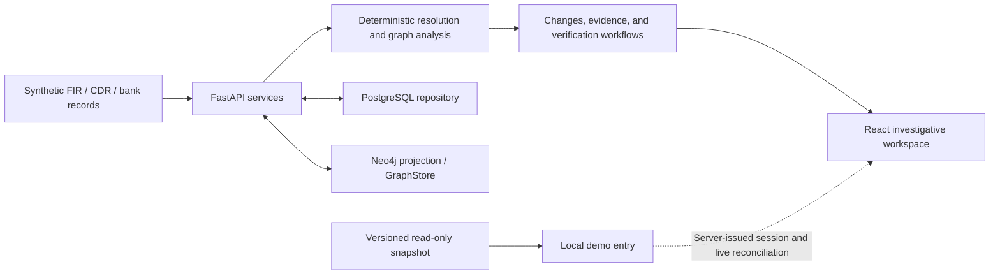

<p align="center">
  
</p>

<h1 align="center">NEXUS</h1>
<p align="center"><strong>Evidence-grounded criminal network change intelligence</strong></p>
<p align="center">Smart India Hackathon 2026 · Problem Statement 26189 · Blockchain & Cybersecurity</p>

<p align="center">
  <a href="https://github.com/acchasujal/Nexus/actions/workflows/ci.yml"></a>
  <a href="docs/SECURITY.md"></a>
  <a href="docs/ARCHITECTURE.md"></a>
</p>

<p align="center">
  <a href="https://nexus-eight-weld-33.vercel.app/login">Try the demo</a> ·
  <a href="docs/PROJECT_REPORT.md">Project report</a> ·
  <a href="docs/DEMO.md">Judge walkthrough</a> ·
  <a href="docs/DEVELOPMENT.md">Developer guide</a>
</p>

## From fragmented records to explainable network changes

An FIR, a call record, and a bank transfer can describe different parts of the same network. NEXUS connects those records, shows how the network changes, and gives an investigator the evidence and verification steps behind each finding.

The central question is **“What changed, why does it matter, and what should we verify next?”**

```text
Observe → Connect → Compare → Review evidence → Verify → Act → Audit
```

Built for the MHA/NCRB problem context, this is an independent synthetic-data evaluation prototype—not an official government deployment. It supports investigation; it does not determine guilt or predict individual criminality.

## What you can explore

| Capability | What it does | Lifecycle |
| --- | --- | --- |
| Investigative graph | Case-centred exploration, paths, communities, and bridge analysis | CURRENT |
| Explainable entity resolution | Compares names and identifiers; exposes reviewable candidate decisions | CURRENT |
| Network change intelligence | Compares snapshots and surfaces evidence-linked review pulses | EXTENSION |
| Evidence workflow | Source verification, evidence assessments, verification tasks, and affected-case routing | EXTENSION |
| Identity and network radars | Identity drift, network adaptation, digital identifier corroboration, and Case DNA | NEW PROTOTYPE |
| Grounded copilot | Uses deterministic tools and source citations, with refusal checks for prohibited questions | CURRENT |
| Audit and dossiers | Hash-chain checks, local Merkle anchoring, and evidence-oriented PDF exports | CURRENT |
| Instant demo entry | Read-only synthetic metrics and ten initial worklist rows, followed by live reconciliation | EXTENSION |

These labels describe implementation scope, not operational certification. Forecast cards are constrained prototype outputs, not calibrated predictions. See [architecture](docs/ARCHITECTURE.md) and [limitations](docs/PROJECT_REPORT.md#limitations-and-next-steps).

## Try the evaluation demo

Open **[NEXUS](https://nexus-eight-weld-33.vercel.app/login)** and choose an officer:

| Demo role | Profile | Focus |
| --- | --- | --- |
| IO | Inspector Rajesh Kumar | Case evidence and connections |
| SHO | SHO Sunita Sharma | Network signals and lead review |
| SP | SP Vikram Hegde | Cross-district coordination |
| ADMIN | Director Priya Mehta | Governance and audit review |

The explicitly configured demo opens a **read-only synthetic workspace immediately**. Its labelled snapshot is bundled with the frontend; it does not represent server authentication.

Background server login enables live metrics, the complete worklist, and a link to the full workspace. The interface distinguishes **Demo snapshot · Connecting**, **Live data connected**, and **Offline demo**. Backend-dependent actions are not exposed in the local demo.

The backend is hosted on Render and may wake slowly. Neo4j-dependent operations can remain unavailable while repository-backed reads work. [Liveness](https://nexus-4djk.onrender.com/health) and [readiness](https://nexus-4djk.onrender.com/ready) answer different questions; the static site loading does not prove database readiness.

## Run locally

Use Python **3.11 or 3.12** and Node.js **22.12+**. CI currently exercises Python 3.11 and Node 20; dependency-wheel availability varies on newer Python/ARM combinations.

From a fresh checkout:

```sh
git clone https://github.com/acchasujal/Nexus.git
cd Nexus
python -m venv .venv
```

Activate the environment with `source .venv/bin/activate` on Linux/macOS or `.\.venv\Scripts\Activate.ps1` in PowerShell. Then:

```sh
python -m pip install -r backend/requirements.txt
python -m uvicorn backend.app.main:app --reload --port 8000
```

In a second terminal:

```sh
cd frontend
npm ci
npm run dev
```

- Frontend: **http://localhost:5173**
- Interactive API: **http://localhost:8000/docs**
- Default local setup: synthetic in-memory repository and graph; no cloud credentials required.
- For local instant entry, put `VITE_DEMO_MODE=true` in ignored `frontend/.env.development.local` and restart Vite.

Use the [developer guide](docs/DEVELOPMENT.md) for environment files, persistent storage, fixture regeneration, and platform notes. The [deployment guide](docs/DEPLOYMENT.md) covers Vercel, Render, and dependency recovery.

## How it fits together



PostgreSQL stores application records when configured. Neo4j is a complementary durable projection with explicit readiness gates. The in-memory `GraphStore` supports deterministic graph algorithms. Optional language-model providers explain tool results; they do not replace graph computation or human verification.

## Evidence and responsible use

- Development and demonstrations use synthetic records only.
- Graph relationships retain provenance; a computed association is not proof of identity or guilt.
- The system separates observed facts, derived links, hypotheses, and investigator decisions.
- Source hashes, audit chains, and Merkle proofs support integrity checking; they do not establish the truth or legal admissibility of a record.
- No raw case records or citizen data belong on a public blockchain.
- The current backend login/verifier is a **demo identity implementation**, not a production identity provider. Do not deploy it with real citizen data.

Read [security and governance](docs/SECURITY.md) before changing authentication, evidence handling, or deployment scope.

## Verification

```sh
python -m ruff check backend/ shared/ tests/
python -m pytest
python scripts/evaluate_ground_truth.py
npm --prefix frontend run test:run
npm --prefix frontend run build
```

The build type-checks TypeScript, regenerates the demo worklist snapshot, and verifies asset closure. [Benchmarks](docs/BENCHMARKS.md) distinguish historical in-memory measurements from deployed latency; [progress](progress.md) records the latest test results and known failures. No static “all tests passed” badge is used as a substitute for a current run.

## Repository guide

| Path | Purpose |
| --- | --- |
| [`backend/app/`](backend/app/) | API, deterministic graph analysis, repositories, and application services |
| [`frontend/src/`](frontend/src/) | Login, read-only demo, investigative pages, and query recovery |
| [`shared/contracts/`](shared/contracts/) | Python and TypeScript API/domain contracts |
| [`synthetic_data/`](synthetic_data/) | Synthetic generators and planted ground truth |
| [`tests/`](tests/) · [`scripts/`](scripts/) | Backend tests, evaluation, migration, and benchmark tooling |
| [`artifacts/`](artifacts/) | Checked-in synthetic inputs and historical measurement records |
| [`docs/`](docs/) | Current technical guides and project report |
| [`docs/archive/`](docs/archive/) | Historical plans, audits, and superseded documentation |

### Documentation

[Project report](docs/PROJECT_REPORT.md) · [Architecture](docs/ARCHITECTURE.md) · [Data model](docs/DATA_MODEL.md) · [API](docs/API.md) · [Intelligence pipeline](docs/INTELLIGENCE_PIPELINE.md) · [Security](docs/SECURITY.md) · [Benchmarks](docs/BENCHMARKS.md) · [Demo](docs/DEMO.md) · [Development](docs/DEVELOPMENT.md) · [Deployment](docs/DEPLOYMENT.md)

[Contributing](CONTRIBUTING.md) · [Architectural decisions](decisions.md) · [Implementation status](progress.md) · [Agent governance](AGENTS.md)
