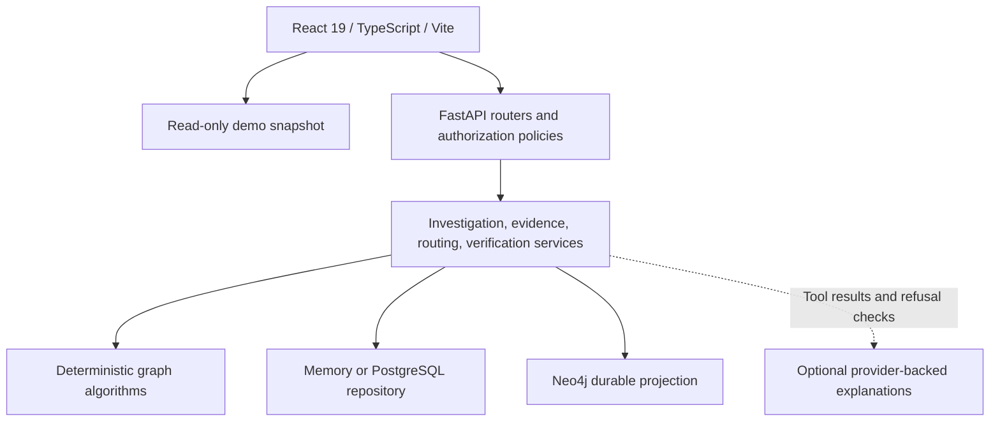

# Architecture

> Reviewed 2026-10-28. Code is authoritative; this guide describes implemented boundaries and explicitly qualified prototypes.

## System boundary

NEXUS is a synthetic investigative intelligence prototype. It combines deterministic graph processing, evidence review workflows, a React workspace, and optional persistent infrastructure. It is not an autonomous policing system or a production identity platform.

## Implemented subsystems

| Subsystem | Lifecycle | Implementation boundary |
| --- | --- | --- |
| Record ingestion and normalization | CURRENT | CSV parsers/mappers, document ingestion, and source provenance under `backend/app/db/ingestion/` and `backend/app/services/` |
| Identity resolution | CURRENT | Deterministic names/identifiers, explicit candidate review, and graph mutation services |
| Graph analysis | CURRENT | `GraphStore` traversals, clustering, centrality, similarity, and bounded subgraph services |
| Snapshots, diffs, and pulses | EXTENSION | `ProactiveIntelligenceService`, snapshot algorithms, canonical read models, and pulse routes |
| Evidence assessments and verification tasks | EXTENSION | First-class records, lifecycle operations, audit events, and closed-loop propagation |
| Identity drift, adaptation, digital shadow, Case DNA | NEW PROTOTYPE | Deterministic analytical slices with dedicated services, routes, and frontend sections |
| Operational forecast cards | NEW PROTOTYPE | Rule-based/demo-derived outputs in the proactive service and canonical fixture; not a calibrated general forecasting model |
| Cross-case routing | EXTENSION | Affected-investigation routes and intelligence packet acknowledgement; not an external inter-agency network |
| Audit and integrity | CURRENT | Source hashes, chained audit records, Merkle proofs, local permissioned ledger, and dossiers |
| Immediate read-only demo | EXTENSION | Explicit frontend demo configuration; no local fabricated authentication |

## Storage authority

### Repository

`InMemoryBackendRepository` supports standalone synthetic development. `PostgresBackendRepository` persists application records and maintains hydrated in-memory indexes. PostgreSQL schema initialization, hydration, and audit preparation are part of application construction.

In PostgreSQL mode, this repository remains the source for cases, evidence metadata, workflow records, and audit records. It is not replaced by a different store when a required dependency fails. Legacy fallback paths expose an unready state rather than silently claiming healthy persistent storage.

### Graph analysis and projection

`GraphStore` contains indexed in-memory graph structures used by deterministic algorithms. It is distinct from the repository and from the Neo4j projection.

Neo4j is the complementary durable graph projection. Startup validates connectivity, ensures schema, synchronizes repository nodes/edges, and reads the durable projection before marking it operational. Parameterized queries and projection gates remain in force. A successful TCP/Bolt check does not establish that schema, sync, or durable reads completed.

Repository-backed reads can serve during Neo4j degradation. Live graph traversal/analytics and graph-changing actions are explicitly gated by [dependencies.py](../backend/app/api/dependencies.py). Do not describe this as an automatic in-memory replacement for a required live projection.

### Private evidence objects

When configured, `EvidenceObjectStorage` stores source bytes in a private S3-compatible bucket using content-addressed keys. Metadata and hashes remain in the repository. Reads verify bytes against the expected digest. S3 client construction is deferred to first use; configuration remains validated at construction.

## Demo and authenticated entry

1. A production evaluation build explicitly sets `VITE_DEMO_MODE=true`.
2. Selecting a role navigates to `/demo` without awaiting an API request.
3. That route shows a labelled, read-only synthetic snapshot. The local role is not an AuthContext session.
4. Background demo login has bounded retry/backoff and an overall 120-second deadline.
5. Only a usable server-issued session enables parallel live bootstrap/worklist reads and the full-workspace link.
6. Server results replace snapshot values. Timeout/failure retains snapshot or last confirmed data with a truthful sync label.
7. Logout, a new login, or cancellation invalidates obsolete responses.

The regular credential form stays separate. Its current backend is still a demo identity implementation; a signed demo token is not proof that a production identity provider verified an officer.

The frontend uses TanStack Query to deduplicate reads and scope caches. Baseline data stays outside successful query-cache entries. Session transitions clear cached results. Recovery is bounded; it does not repeatedly replay mutations.

## Startup and readiness

Production normally starts the graph task in the application lifespan. `NEO4J_BACKGROUND_STARTUP=false` preserves blocking behavior; development defaults differ. Background connection delays are 0, 2, 4, 30, and 60 seconds, with at most five attempts. Projection schema/sync/read run only after connection succeeds.

Mandatory repository and integrity preparation remain synchronous. Optional PDF libraries and S3 client setup move to their actual operations. Shutdown cancels and awaits background work before closing resources.

- `/health`: process liveness.
- `/ready`: storage and configured dependency policy; distinguishes graph connectivity from an operational projection.
- Startup diagnostics expose stage timings without credentials. Factory-to-ready timing excludes module imports and platform scheduling.

See [deployment](DEPLOYMENT.md) for configuration and dated observations in [progress](../progress.md).

## Intelligence and trust boundaries

Deterministic code owns entity matching, traversal, clustering, and diff computation. Optional LLM use is limited to intent handling/explanation over tool results and citation-bearing responses, with prohibited-query checks. An explanation is not an independent evidence source.

Observed records, algorithmic associations, prototype forecasts, and investigator decisions remain distinct. The model supports abstention, including `INSUFFICIENT EVIDENCE / NO FORECAST`; prototype constants and fixture scenarios are not operational probability estimates.

The local ledger is not a deployed Hyperledger network. Cross-service atomic recovery, external-agency federation, production-grade identity, and field validation are TARGET / FUTURE work. Read [security](SECURITY.md) and the [project report](PROJECT_REPORT.md) for limits.
