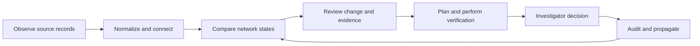

# Intelligence pipeline

> Reviewed 2026-10-28. The pipeline separates deterministic processing, prototype analytical outputs, and human decisions.

## Operating loop

This is an investigative workflow, not an automatic declaration of criminality.

## Implemented stages and limits

| Stage | Lifecycle | Code and behavior |
| --- | --- | --- |
| 1. Intake | CURRENT | CSV FIR/CDR/bank/intelligence/surveillance parsing and document upload; provenance and validation are retained |
| 2. Normalize/extract | CURRENT / EXTENSION | Normalizes identifiers and names; document extraction emits reviewable candidate entities/relationships |
| 3. Resolve identity | CURRENT | Deterministic phonetic/name/identifier comparison produces explainable candidate matches |
| 4. Review and mutate | EXTENSION | Authorized candidate decisions and graph-mutation services apply explicit accepted changes |
| 5. Capture and compare | EXTENSION | Snapshot summaries and structural graph diffs expose node/relationship deltas |
| 6. Prioritize review | EXTENSION | Network pulses group changes and attach review priority, scope, evidence, and verification suggestions |
| 7. Assess evidence | EXTENSION | First-class assessments and pulse assessment views represent SUPPORTS, CONFLICTS, MISSING, INFERRED, VERIFIED |
| 8. Corroborate patterns | NEW PROTOTYPE | Identity drift, network adaptation, digital identifier corroboration, and Case DNA |
| 9. Constrain/abstain | NEW PROTOTYPE | Rule-based forecast examples and sparse-input abstention; not empirically calibrated future crime prediction |
| 10. Track verification | EXTENSION | Persistent task creation, assignment, state transitions, evidence attachment, and review decisions |
| 11. Route and learn from decisions | EXTENSION | Intelligence events, affected-investigation routes, propagation results, and audit history |

The former roadmap-only description of snapshots, pulses, tasks, and assessments is superseded by these implemented services and [API routes](API.md).

## Evidence before conclusions

Each analytical view should retain the route back to its source. A derived graph path or similarity match is an investigative association. It is not an observed event simply because an algorithm computed it.

The UI and contracts distinguish:

1. Observed source records.
2. Derived graph relationships.
3. Hypotheses and prototype forecast cards.
4. Investigator review and verification decisions.

Review priority measures workflow urgency, not guilt. A verification task is not complete merely because an assessment exists.

## Actual service boundaries

- [CsvIngestionPipeline](../backend/app/db/ingestion/pipeline.py) performs structured intake, mapping, and identity-registry work.
- [DocumentExtractionService](../backend/app/services/document_extraction_service.py) emits source-grounded candidates; extraction itself is not authorization to merge.
- [GraphMutationService](../backend/app/services/graph_mutation_service.py) handles authorized graph changes.
- [ProactiveIntelligenceService](../backend/app/services/proactive_intelligence_service.py) builds snapshot/diff/pulse views.
- [EvidenceAssessmentService](../backend/app/services/evidence_assessment_service.py) manages assessment records and revisions. It does not itself mutate the graph, auto-complete tasks, or start propagation.
- [VerificationTaskService](../backend/app/services/verification_task_service.py) manages task lifecycle. Task creation/transition is not a graph mutation.
- [ClosedLoopPropagationService](../backend/app/services/closed_loop_propagation_service.py) and [AffectedInvestigationRoutingService](../backend/app/services/affected_investigation_routing_service.py) own their respective propagation/routing work.
- [AuditService](../backend/app/services/audit_service.py) records supported operations; integrity verification is an explicit check.

These boundaries avoid falsely implying that every event automatically triggers every downstream action.

## Forecast prototype scope

`ForecastItem` represents allowed operational/topological targets such as communication-pattern shift, identifier drift, and network restructuring. The current service and canonical fixture include example support levels, time windows, and suggested actions.

Those values are not calibrated probabilities, and fixture-specific windows are not current operational deadlines. Sparse graph changes can produce `INSUFFICIENT EVIDENCE / NO FORECAST`; this demonstrates an abstention path, not field validation across every stale/contradictory scenario.

General forecasting quality, uncertainty calibration, and external validation remain TARGET / FUTURE. Individual guilt, recidivism, dangerousness, or deceptive-intent scoring is REJECTED.

## Copilot boundary

The copilot uses deterministic tools and citation-bearing results, with an optional provider for explanation and prohibited-query checks. Without provider configuration it has deterministic fallback behavior. Do not describe language-model output as a new evidence source.

## UI delivery and recovery

The local demo shows canonical synthetic data before server login finishes. It does not run the full backend pipeline in the browser or create a local authenticated officer. After a server session, live metrics/worklist reads reconcile asynchronously.

Query failures retain labelled snapshot or last confirmed data instead of silently producing zero counts. Secondary graph/analytical reads can fail independently. Graph readiness gates still apply; read-only availability is not permission to replay decisions or ingestion requests.

## Evaluation

Use [BENCHMARKS.md](BENCHMARKS.md) for recorded synthetic workloads and their limits. Ground-truth tests validate planted cases, not the predictive accuracy of a deployed policing system. [progress.md](../progress.md) distinguishes component tests, warm HTTP checks, simulated failures, and unverified browser/cold-start claims.
